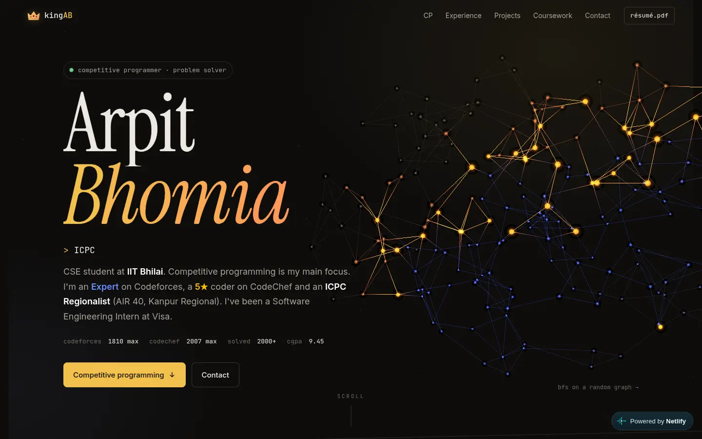
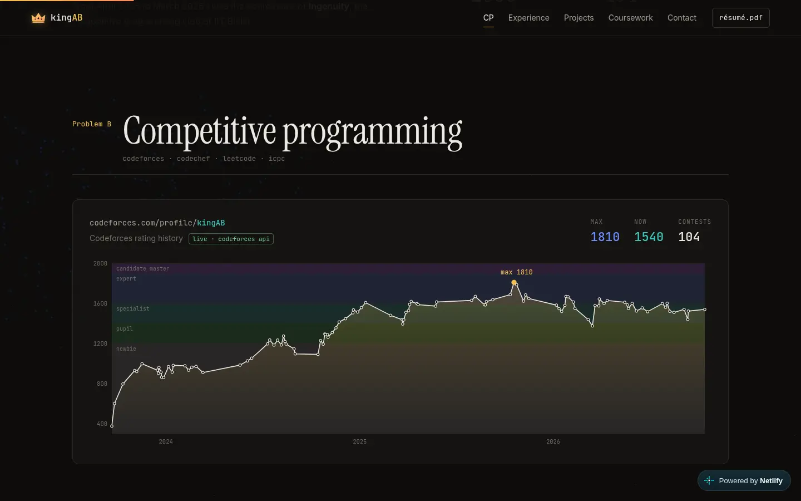
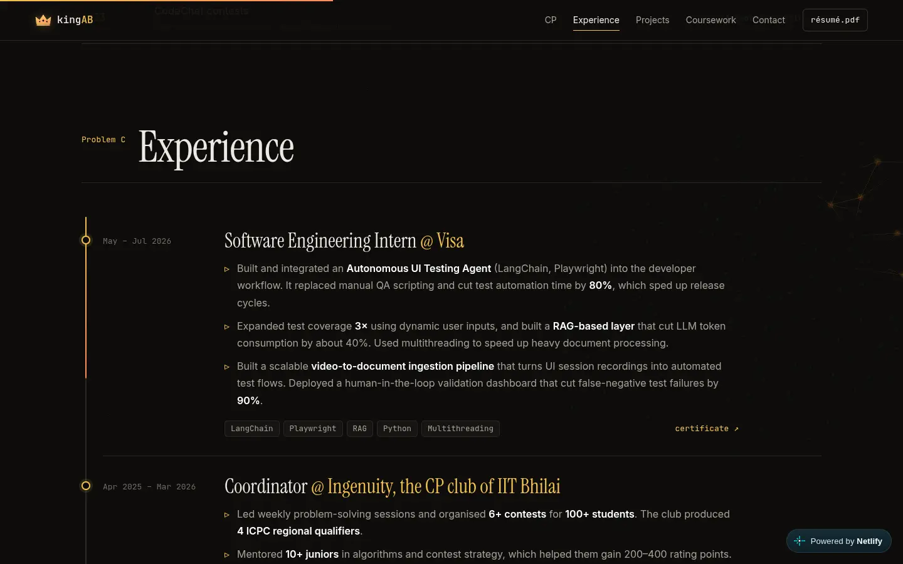
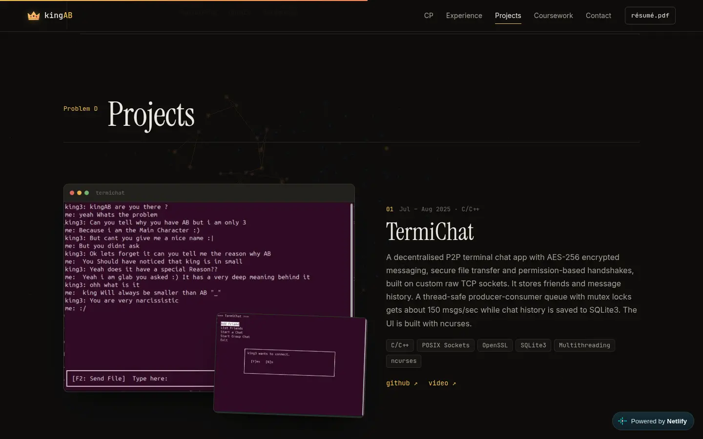
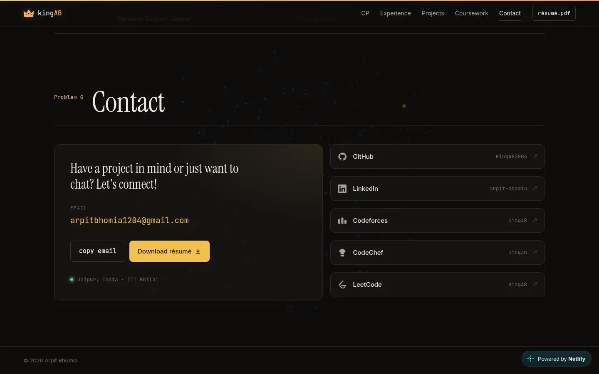
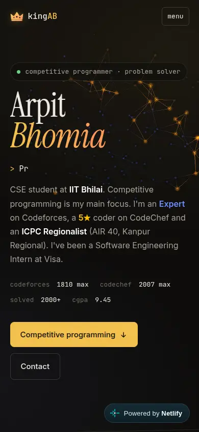

<div align="center">


# kingAB · Portfolio

**Arpit Bhomia** · Competitive Programmer & Problem Solver · CSE @ IIT Bhilai

<a href="https://kingab-portfolio.netlify.app"></a>

<a href="https://app.netlify.com/projects/kingab-portfolio/deploys"></a>


<br />

<a href="https://kingab-portfolio.netlify.app">
  
</a>

<sub>The background is a random graph with a BFS wavefront running through it, rendered with Three.js.</sub>

</div>

<br />

## ✦ At a glance

<table>
  <tr>
    <td align="center"><b>1810</b><br /><sub>Codeforces max · Expert</sub></td>
    <td align="center"><b>2007</b><br /><sub>CodeChef max · 5★</sub></td>
    <td align="center"><b>AIR 40</b><br /><sub>ICPC Kanpur Regional</sub></td>
    <td align="center"><b>2000+</b><br /><sub>problems solved</sub></td>
    <td align="center"><b>9.45</b><br /><sub>CGPA, IIT Bhilai</sub></td>
  </tr>
</table>

## ✦ What's on the site

| Section | What it shows |
| --- | --- |
| **Hero** | Name, typed roles, quick stats, the BFS graph background |
| **A · About me** | Short intro and six count-up stat cards |
| **B · Competitive programming** | Codeforces rating graph (fetched live from the Codeforces API, with a snapshot fallback), problems by tag and by rating, platform cards, contest results with certificates |
| **C · Experience** | Visa SWE internship, Ingenuity CP club coordinator, Inter-IIT Tech Meet, DSAI Club |
| **D · Projects** | TermiChat, Custom OS Scheduler, Warranty Storage, CP Butler, Bomberman AI, with real screenshots |
| **E · Coursework** | IIT Bhilai courses grouped by area, with grades |
| **F · Education & achievements** | IIT Bhilai, JEE Advanced, ATF 2024, IIT Guwahati bootcamp, school |
| **G · Contact** | Email, résumé download and profile links |

## ✦ Screenshots

<table>
  <tr>
    <td width="50%"></td>
    <td width="50%"></td>
  </tr>
  <tr>
    <td width="50%"></td>
    <td width="50%"></td>
  </tr>
</table>

<p align="center">
  
  <br /><sub>Mobile layout</sub>
</p>

## ✦ How it's built

Plain HTML, CSS and JavaScript. There is no framework and no build step, and the only library is Three.js.

**Animation**
- Short intro screen, then the name rises in letter by letter
- Section titles reveal per letter and their underlines draw in
- Screenshots wipe in and drift slightly as you scroll (CSS scroll-driven animations)
- Experience timeline fills on scroll, plus a scroll progress bar
- Cursor ring, magnetic buttons, 3D tilt and a spotlight on cards
- Rating line draws itself, and the bars and counters animate in

**Performance**
- Animations only touch `transform`, `translate`, `opacity` and `clip-path`. There is no `backdrop-filter` and no animated `box-shadow`.
- `graph.js` (Three.js) is loaded only after the page is idle. It runs at full speed in the hero and at 30 fps behind the content, and it stops when the tab is hidden.
- Adaptive quality: if frames run slow, the background drops resolution, then frame rate, and finally freezes on a still frame.
- Looping hero animations and the marquee pause when they're off screen.
- Images are resized WebP (about 240 KB in total), lazy-loaded with fixed dimensions.
- `prefers-reduced-motion` turns the motion off.

## ✦ Project structure

```text
.
├── netlify.toml            # publish = "site"
├── site/
│   ├── index.html
│   ├── css/style.css
│   ├── js/
│   │   ├── main.js         # reveals, chart, typing, cursor, tilt, fallbacks
│   │   └── graph.js        # Three.js BFS-graph background (lazy-loaded)
│   └── assets/
│       ├── Arpit_Bhomia_Resume.pdf
│       └── img/            # project screenshots (WebP)
└── docs/                   # README images (not deployed)
```

## ✦ Run locally

```bash
git clone https://github.com/KingAB2004/Portfolio.git
cd Portfolio/site
python3 -m http.server 8000
# open http://localhost:8000
```

The page needs to be served over HTTP, because `graph.js` is an ES module.

## ✦ Deploy

The site is hosted on Netlify, and `netlify.toml` publishes the `site/` folder.

```bash
npx netlify-cli deploy --prod --dir site
```

## ✦ Connect

<p>
  <a href="https://kingab-portfolio.netlify.app"></a>
  <a href="https://github.com/KingAB2004"></a>
  <a href="https://www.linkedin.com/in/arpit-bhomia-52783b28a/"></a>
  <a href="https://codeforces.com/profile/kingAB"></a>
  <a href="https://www.codechef.com/users/kingab"></a>
  <a href="https://leetcode.com/u/KingAB/"></a>
  <a href="mailto:arpitbhomia1204@gmail.com"></a>
</p>

<div align="center">
<sub>© 2026 Arpit Bhomia</sub>
</div>
